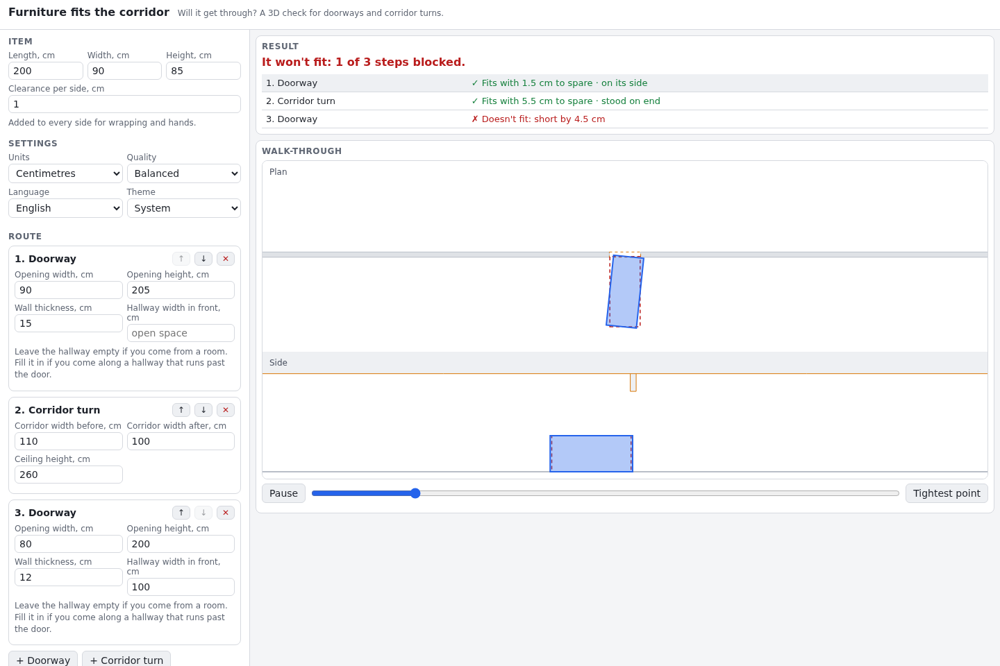

# Furniture Fits the Corridor

Will your sofa get through the door? Enter the furniture's size and every doorway and corridor turn on the way in. The calculator searches in 3D, turning the item and tilting it up, and tells you whether it fits, how much room is left, and how to hold it. It then animates the move.

**Try it: [hermes98761234.github.io/furniture-fits-the-corridor](https://hermes98761234.github.io/furniture-fits-the-corridor/)**

[](https://github.com/hermes98761234/furniture-fits-the-corridor/actions/workflows/deploy.yml)



## Features

- **A real 3D search.** It tries the item lying flat, on its side and stood on end, rotated and tilted up to 90°, under your actual ceiling height.
- **Doorways and 90° corridor turns**, chained into a route. A doorway can open off a narrow hallway, which is the case that usually bites.
- **Margin, not just yes/no.** You get "fits with 3.5 cm to spare" or "short by 4 cm", including the clearance you add for wrapping and hands.
- **An animated walk-through** in plan and side view, with a jump to the tightest point.
- **Centimetres or inches, English or Ukrainian, light or dark theme.** Your inputs are remembered in the browser.
- **Nothing to install.** It runs in any modern browser, and the heavy maths runs in Web Workers, one per step, in parallel.

## How it works

Each step becomes a set of box-shaped obstacles: walls, the ceiling, and the wall around a door opening. The item is a box resting on the floor. Its pose is position, yaw and tilt, plus which side is up.

For every pose on a grid, the solver works out in closed form how many centimetres the box could grow on every side before touching anything. It uses the separating-axis test, one axis at a time. A widest-path search over that 4D grid then finds the route from the start line to the far side whose tightest pose has the most room. That room is the margin. A negative margin is how much smaller the item would need to be.

The grid sets the precision. Margins can read up to about one grid step low (2–4 cm depending on the quality setting), so leave a little extra room.

The solver is checked against the classic 2D "sofa round a corner" formula.

## Quick start

You need [Node.js](https://nodejs.org/) 22.

```bash
git clone https://github.com/hermes98761234/furniture-fits-the-corridor.git
cd furniture-fits-the-corridor
npm install
npm run dev       # http://localhost:5173
npm test          # solver, model and i18n tests
npm run build     # static site in dist/
```

## License

MIT
